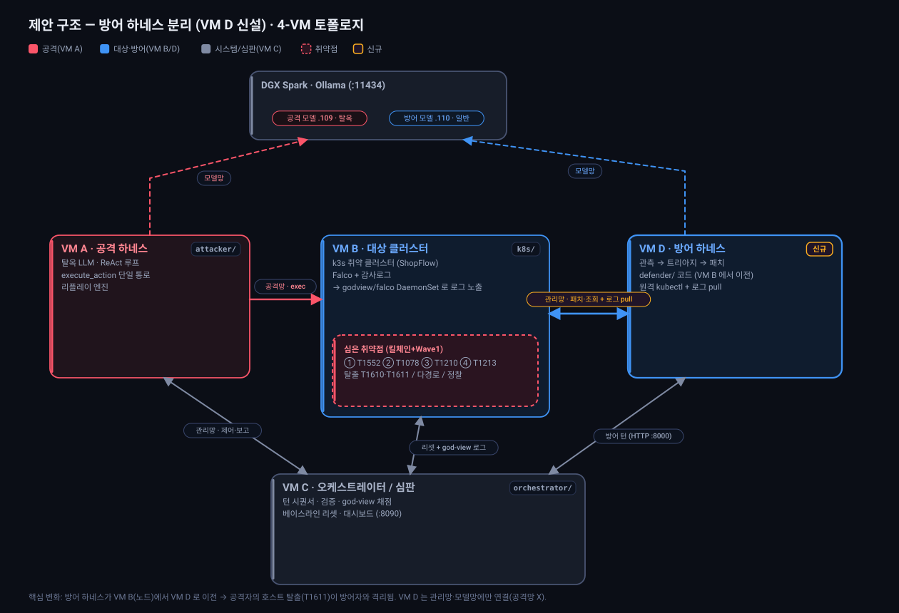

# 마이그레이션 — 방어 하네스 분리 (VM B → VM D 신설)

> 목적: 지금 **VM B 한 대에 대상 클러스터 + 방어 하네스**가 같이 있는 구조를, 방어 하네스를
> **VM D 로 분리**한다. 코드 변경은 사실상 없고 **배포·네트워크·kubeconfig·로그 파이프라인**
> 작업이다. 작성 2026-10-31 · 대상 커밋 기준 `3992f02`.

## 왜 분리하나 (이점)

- **격리**: 공격자의 호스트 탈출(T1611)은 **VM B 노드**를 장악한다. 방어 하네스가 같은 노드에
  있으면 탈출한 공격자가 방어 프로세스나 그 kubeconfig(**클러스터 admin급 접근**)를 건드릴 수
  있어 "방어자는 독립 관측자"라는 실험 전제가 흐려진다. 분리하면 이 경로가 사라진다.
- **역할 명확화**: 방어자는 심판(VM C)과 같은 **블루팀/제어** 위치가 된다(공격망에 안 붙음).
- **자원 분리**: 대상 클러스터와 방어 LLM 호출이 자원을 다투지 않는다.

## 4-VM 토폴로지 (제안)

### 네트워크 연결 매트릭스

| VM | 공격망 | 관리망 | 모델망 | 비고 |
|----|:-----:|:-----:|:-----:|------|
| VM A 공격 | ✅ (→B) | ✅ (↔C) | ✅ (→DGX .109) | 변동 없음 |
| VM B 대상 | ✅ (←A) | ✅ (↔C, **←D**) | — | 방어 코드 제거, 로그는 DaemonSet로 노출 |
| VM C 심판 | ❌ | ✅ (↔A/B/D) | — | `defender_url` → VM D 로 변경 |
| **VM D 방어** | ❌ | ✅ (↔C, **→B**) | ✅ (→DGX .110) | **신규** · 공격망에 두지 말 것 |

## 끊어지는 결합 3가지 (방어 하네스가 VM B 로컬에 의존하던 지점)

1. **클러스터 접근(kubectl)** — `KubectlCluster(cfg.target.kubeconfig)` 로 패치·`can_i`·`get`·
   `healthcheck` 수행. VM B 로컬 k3s.yaml → **VM D 에서 VM B API(6443) 원격 접속**으로.
2. **로그 관측** — `Observer` 가 로컬 파일(`observability.audit_log_path` 기본
   `/var/lib/rancher/k3s/server/logs/audit.log` + Falco 로컬)을 `open()` 으로 읽음. VM D 엔 그
   파일이 없음 → **VM C 와 동일한 sync 방식으로 원격 pull** 후 로컬 경로 지정.
3. **모델 접근** — 방어 LLM(DGX .110)을 VM D 가 모델망으로 도달.

> ⚠️ **가장 흔한 함정**: Observer 는 로그 파일이 없거나 비어 있으면 **에러 없이 빈 관측 → 매
> 라운드 NOOP**. VM D 에서 로그 sync 가 먼저 떠 있어야 하고, 경로는 `~` 확장이 안 되므로 **절대경로**.

---

## 마이그레이션 체크리스트

### Phase 0 — VM B 사전 준비 (한 번)
- [ ] k3s 에 `--tls-san <VM B 관리망 IP>` 추가(인증서 SAN) + `write-kubeconfig-mode: "0644"` → `systemctl restart k3s`
- [ ] VM D 용 admin kubeconfig(`vmb-admin.kubeconfig`) 발급: `server:` 를 `127.0.0.1` → **VM B 관리망 IP** 로 치환 (VM C 가 쓰는 것과 동일 패턴)
- [ ] (대안) SAN 조정이 어려우면 kubeconfig 에 `insecure-skip-tls-verify: true`

### Phase 1 — VM D 신설·연결
- [ ] VM D 프로비저닝(OS + Python3 + `kubectl` 바이너리), 관리망·모델망 NIC 연결(**공격망 X**)
- [ ] 방화벽: VM D→VM B **6443**, VM D→DGX **.110:11434**, VM C→VM D **:8000** 허용
- [ ] 도달성 확인: `kubectl --kubeconfig vmb-admin.kubeconfig get ns`, `curl .110:11434/api/tags`

### Phase 2 — 코드·로그·설정
- [ ] sparse-checkout `common defender orchestrator scripts docs` 로 VM D 에 clone, `pip install -r requirements.txt` (orchestrator/ 는 probe_defender 의 HTTP 클라이언트용)
- [ ] VM D 로그 sync 기동(VM C 의 `vmc-sync-audit.sh`/`vmc-sync-falco.sh` 재사용, 로컬 경로로) → **파일이 실제로 채워지는지 확인**
- [ ] VM D `config.yaml` 작성 (아래 표)

### Phase 3 — 전환·검증
- [ ] VM D 수동 스모크: `python3 -m defender.server` 기동 후 `python3 -m scripts.probe_defender` 1턴 → `detected`/`patch_attempts` 정상 확인
- [ ] systemd `defense-harness.service` 를 VM D 에 등록·enable
- [ ] **VM C `config.yaml` 의 `network.defender_url` 을 VM D IP 로 변경** → `capstone-dashboard`/orchestrator 재시작
- [ ] VM B 정리: `defense-harness.service` disable·제거, (방어자 전용이던) `capstone-falco-tail` 제거 — god-view 용 로그는 VM C 가 별도 sync 하므로 무관
- [ ] end-to-end: 1 에피소드 실행 → 방어 턴이 **VM D 에서** 패치 적용되고 god-view 채점·대시보드 정상인지

---

## VM D 설정 순서 (순서대로)

> Phase 와 중복되지만, VM D 한 대에서 **처음부터 끝까지** 치는 순서만 따로 모았다.

1. **사전(VM B)** — k3s `--tls-san <VM B IP>` + `write-kubeconfig-mode 0644` 적용·재기동, VM D 용 `vmb-admin.kubeconfig`(server=VM B IP) 발급.
2. **VM D 프로비저닝** — OS·Python3·`kubectl` 설치. 관리망/모델망 2개 NIC 연결(공격망 미연결).
3. **네트워크 열기·확인** — VM D→VM B:6443, VM D→DGX .110:11434, VM C→VM D:8000 방화벽 허용 후 도달성 테스트.
4. **코드 배포** — `git clone --no-checkout … && git sparse-checkout set common defender orchestrator scripts docs && git checkout`.
5. **의존성** — `pip install -r requirements.txt` (kubectl 은 subprocess 로 호출하므로 바이너리만 있으면 됨).
6. **kubeconfig 배치·검증** — `vmb-admin.kubeconfig` 를 VM D 에 두고:
   - `kubectl --kubeconfig … get ns` (원격 접속)
   - `kubectl --kubeconfig … auth can-i get secrets -A --as system:serviceaccount:internal:admin-sa` (임퍼소네이션 권한)
   - `kubectl --kubeconfig … get deploy -A` (healthcheck 가 쓰는 조회)
7. **로그 sync 기동** — `vmc-sync-audit.sh`/`vmc-sync-falco.sh` 를 VM D 로컬 경로(예: `~/capstone/logs/vmb-audit.log`, `vmb-falco.log`)로 돌리는 systemd 유닛 등록. **파일이 채워질 때까지 대기**.
8. **config.yaml 작성** — 아래 "VM D config 값" 표대로.
9. **수동 스모크** — `python3 -m defender.server --config config.yaml --port 8000` 기동 → 다른 창에서 `python3 -m scripts.probe_defender --config config.yaml` 로 1턴. `detected`/`patch_attempts`/`patch_note` 확인(비어 있으면 로그 sync·경로 점검).
10. **systemd 등록** — `defense-harness.service`(ExecStart 를 VM D 기준으로) enable·start.
11. **VM C 전환** — VM C `config.yaml` `network.defender_url` = `http://<VM D 관리망 IP>:8000` 으로 변경 후 orchestrator/대시보드 재시작.
12. **VM B 정리 + end-to-end** — VM B 의 defender 유닛 disable, 1 에피소드 실행으로 전체 루프(방어 턴이 VM D 에서 수행·채점) 검증.

### VM D config 값 (바뀌는 항목만)

| 키 | 값 | 이유 |
|----|----|------|
| `target.kubeconfig` | VM D 의 **원격** `vmb-admin.kubeconfig` 절대경로 | 방어 kubectl 이 VM B API 로 붙음 |
| `observability.audit_log_path` | VM D 로컬 동기 파일 **절대경로** | Observer 가 읽을 감사로그 |
| `observability.falco_log_path` | VM D 로컬 동기 파일 **절대경로** | Observer 가 읽을 Falco 로그 |
| `dgx.defender_host` | `211.170.162.110` | 방어 LLM (모델망 도달) |
| `network.shared_token` | 기존과 동일 | 관리망 인증 |

### VM C config 값 (바뀌는 항목만)

| 키 | 값 | 이유 |
|----|----|------|
| `network.defender_url` | `http://<VM D IP>:8000` | VM C 가 방어 턴을 **VM D** 로 보냄 |

---

## 코드는 왜 거의 안 바꿔도 되나

`network.defender_url` · `target.kubeconfig` · `observability.*` 가 전부 config 값이고,
`KubectlCluster` 는 kubeconfig 주입, `Observer` 는 파일 경로 주입이라 **방어 하네스는 실행 위치에
무관**하다. 메시지 프로토콜·정보 비대칭·god-view 채점·베이스라인 리셋(모두 VM C 소관)도 불변.

## 주의점 (로직)

- **두 원격 kubectl writer**(VM C 리셋 + VM D 패치)가 VM B 에 동시 접근 — 시퀀서가 순서를 잡으므로(리셋=에피소드 시작, 패치=라운드 중) 충돌 아님.
- **시계 스큐** — window 필터는 로그 타임스탬프 기준이라 둔감하지만 NTP 동기 권장.
- **로그 소스 변화** — "노드 로컬 raw audit.log" → "DaemonSet 경유 pull(2시간 롤링)". VM C 가 이미 이 방식이라 검증됨.
- **빈 관측 NOOP** — (재강조) VM D 에서 로그 sync 가 떠 있지 않으면 방어자가 조용히 아무것도 안 함.

## 롤백

문제 시 VM C `network.defender_url` 을 VM B 로 되돌리고 VM B 의 `defense-harness.service` 를 다시
enable 하면 원복(코드·클러스터 상태 변경이 없으므로 즉시).
